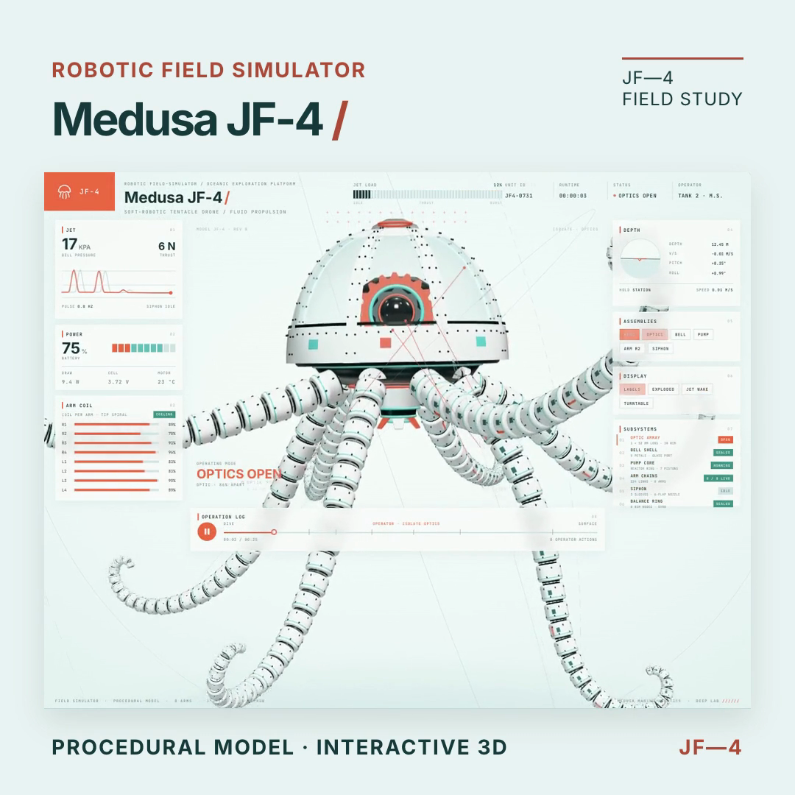

# Medusa JF-4 Field Simulator

An interactive, browser-based visualization of a fictional robotic jellyfish. Explore a procedural 3D model and follow a 25-second operation sequence through a telemetry-inspired dashboard.



[Watch the square MP4 preview](preview.mp4)

## Features

- Explore the model's optic, bell, pump, arm and siphon assemblies.
- Toggle labels, exploded view, jet wake and turntable display modes.
- Drag the model to orbit the camera; use the operation log to scrub or pause the sequence. The space bar also toggles playback.
- Watch simulated jet, power, arm and depth readings change during the sequence.

The interface and readings are illustrative simulations, not controls or measurements for a physical vehicle.

## Getting started

Requirements: Node.js 22.12 or newer and npm. A WebGL-capable browser and an internet connection are needed to load Three.js and fonts from their CDNs.

```sh
npm install
npm run dev
```

Open the local URL printed by Vite (normally http://localhost:3000). No API key is needed for the simulator.

## Commands

```sh
npm run build    # Build the production site in dist/
npm run preview  # Preview the production build locally
npm run lint     # Run the TypeScript check
```

## Built with

React, TypeScript, Vite and Three.js. The model and its animation are generated procedurally in `src/medusa.js`.
